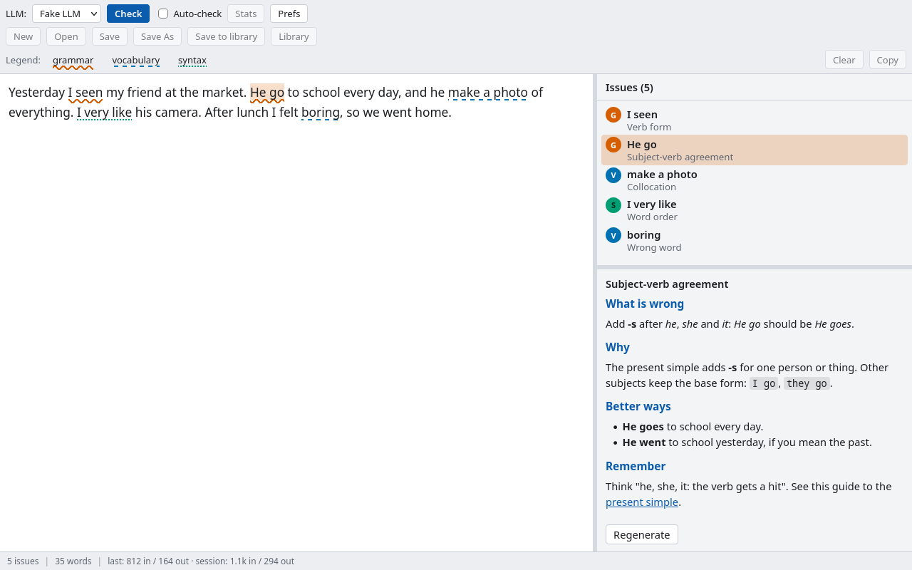
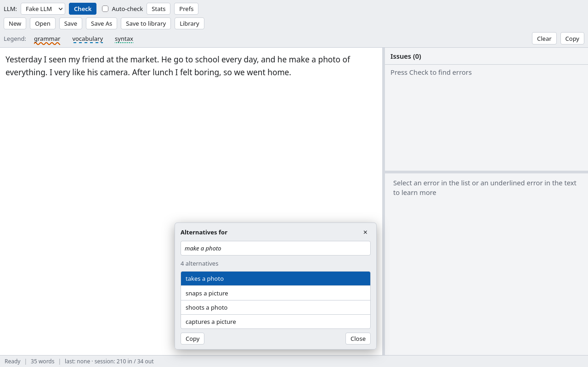
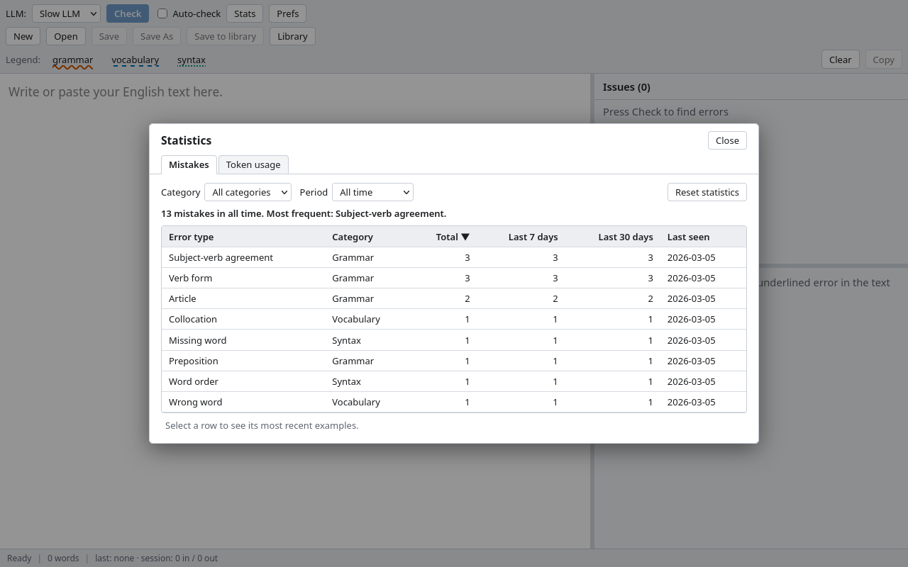
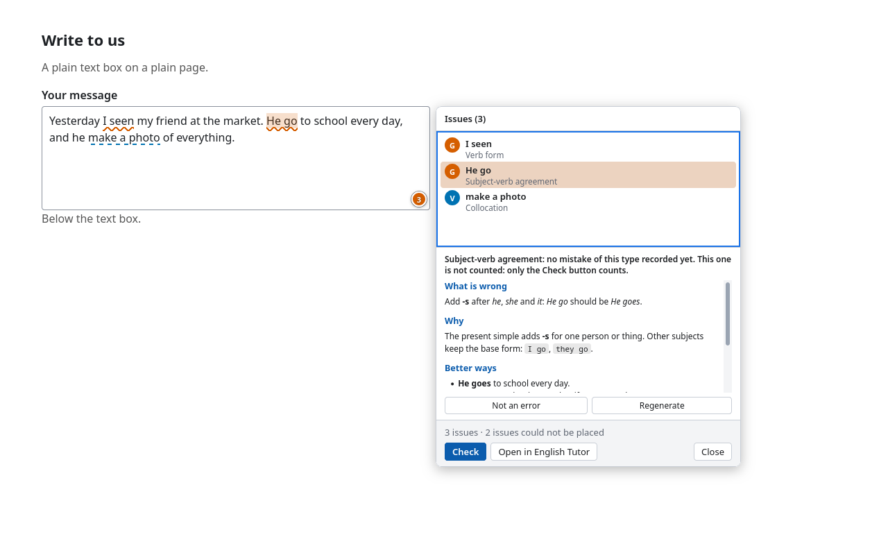

# English Tutor for Firefox

Practise written English with the help of a language model. You write in the editor page, the model finds grammar, vocabulary and syntax errors, and the page underlines each one. Select an error to read why it is wrong, ask for other ways to write a word or a sentence, and watch which mistakes you make most often.

It is the Firefox version of the desktop app [English Tutor](https://github.com/rm4n0s/english-tutor). It works with the language model that **you** configure: [Ollama](https://ollama.com) on your own computer, any OpenAI-compatible server, or Anthropic's Claude. There is no account and no server of ours.



## What it does

- **Finds errors.** Press **Check** (`Ctrl+Enter`). Errors are underlined by category: wavy for grammar, dashed for vocabulary, dotted for syntax. Turn on **Auto-check** to check after you stop typing.
- **Explains them.** Click an underlined error, or a row in the list, and the LLM explains it in a side panel, with better ways to write it.
- **Suggests alternatives.** Select a word, a sentence or a paragraph, right-click and choose **Alternative**.
- **Counts your mistakes.** Every manual check is counted by error type, so the **Stats** dialog shows what to work on. A text checked twice is counted once.
- **Checks text from any page.** Select text on a web page, right-click, and choose **English Tutor**, then **Check with English Tutor** or **Alternatives with English Tutor**.
- **Checks text boxes on web pages, in place.** Turn on [page mode](#page-mode) for a site and it underlines the errors in the text boxes you write in, with a badge, an explanation on a click, and a dialog with all the issues.
- **Keeps your texts.** Open and save text files, or keep texts in a library inside the extension. A tab keeps its text when you reload it.





## Install

English Tutor needs Firefox 140 or newer. It is not listed on addons.mozilla.org. Each release is signed by Mozilla and published in the public releases repository, [rm4n0s/english-tutor-releases](https://github.com/rm4n0s/english-tutor-releases) (this code repository is private).

1. Download `english-tutor-<version>.xpi` from the [latest release](https://github.com/rm4n0s/english-tutor-releases/releases/latest).
2. Open it in Firefox (**File, Open File...**), or drag it onto a Firefox window, and click **Add**. A welcome page opens.
3. Updates arrive by themselves.

The full guide, with the first steps for each provider, page mode, privacy and how to uninstall, is [docs/INSTALL.md](docs/INSTALL.md). It is also the README of the releases repository.

### From source (for developers)

You need [Node.js](https://nodejs.org) 24 or newer.

```sh
git clone https://github.com/rm4n0s/english-tutor-plugin-firefox
cd english-tutor-plugin-firefox
npm ci
npm run build
npm run start
```

`npm run start` opens a Firefox with a temporary profile that has the extension loaded (you will have to add your LLM again in each new temporary profile).

To use it in your own Firefox instead:

1. Run `npm run build`.
2. Open `about:debugging#/runtime/this-firefox`, press **Load Temporary Add-on...** and choose `dist/manifest.json`.
3. The extension stays until you close Firefox. It does not survive a restart.

`npm run package` makes an unsigned zip in `web-ext-artifacts/`. Firefox Developer Edition, Nightly and ESR can install an unsigned zip when `xpinstall.signatures.required` is set to `false` in `about:config`. Release Firefox cannot: use a signed release.

Releases are made by the maintainer: see [docs/RELEASING.md](docs/RELEASING.md).

The extension does not work in private windows.

## First steps

1. Click the English Tutor button in the toolbar (or press `Alt+Shift+E`). The editor opens in a tab.
2. Press **Prefs** and, under **LLMs**, press **Add**. Choose the provider, as below, and press **Save**. Firefox asks to let English Tutor reach the server's address; allow it. **Test connection** checks that the server answers.
3. Go back to the editor, write some English with a mistake in it ("He go to school every day"), and press **Check**.

### Ollama

Ollama runs models on your own computer, so your text never leaves it.

1. Install Ollama and pull a model, for example `ollama pull llama3.1`.
2. Ollama refuses requests from browser extensions unless it is told to accept them. Start it with `OLLAMA_ORIGINS=moz-extension://*`:

   ```sh
   OLLAMA_ORIGINS="moz-extension://*" ollama serve
   ```

   If Ollama runs as a service, put the variable in the service's environment (for example `systemctl edit ollama` and add `Environment="OLLAMA_ORIGINS=moz-extension://*"`), then restart it. Without it, a check fails with "Ollama refused the request from the extension".

3. In English Tutor: provider **ollama**, the model name you pulled, and the Base URL `http://localhost:11434` (it is filled in for you). No key is needed.

### An OpenAI-compatible server

This is for OpenAI itself, and for servers such as LM Studio, llama.cpp's server, vLLM or OpenRouter.

- Provider **openai-compatible**, the model's name, and the Base URL **including `/v1`**, for example `https://api.openai.com/v1` or `http://localhost:1234/v1`.
- The API key, if the server wants one.
- A server that checks the `Origin` header may need to be told to accept `moz-extension://*`.

### Anthropic (Claude)

- Provider **anthropic**, a model such as `claude-sonnet-5-5`, and your API key. The Base URL can stay empty.

Small local models sometimes answer in a form the extension cannot read. It retries once, and then tells you. A larger model usually helps.

### Page mode

Page mode does in a web page's text boxes what the editor does: it underlines the errors in the box, shows a badge with their number, explains one when you click it, and has a dialog with the list of issues and their explanations. It is off everywhere until you turn it on, because it sends what you type to your LLM.



**Turning it on.**

1. Allow it once. On the welcome page that opens when you install the extension, press **Allow** under "Offer to check what you write on websites". Later you can tick **Offer to check text boxes on websites** in **Prefs**, under **General**. Firefox asks for access to all websites; this only lets English Tutor see which site a tab shows. It reads nothing yet.
2. The first time you click into a text box on a site, a small card asks about that site: **Turn on**, **Not now** or **Never on this site**. **Turn on** starts checking at once. **Not now** asks again after Firefox restarts. **Never on this site** stops asking. Each host name is its own site (`mail.example.com` and `docs.example.com` are asked separately).

**Using it.**

- Click into a text box with at least three words. It is checked, and a round badge appears at its bottom right corner: a spinner while checking, the number of errors, a check mark for none, or `!` when something is wrong (no LLM, a failed check, a text over 10,000 words).
- Errors are underlined in the box as in the editor. Click an underlined error to see its explanation next to it, with **Not an error**, **Regenerate** and **All issues**. `Escape`, a click elsewhere or typing closes it.
- Click the badge (or **All issues**) to open the dialog: the issues on top, the explanation of the selected one below. Selecting a row highlights the error in the text box and scrolls to it, without moving your cursor. **Check** runs a check that counts, **Open in English Tutor** sends the box's text to the editor in a new tab, and **Close** (or `Escape`) closes it. English Tutor never writes a correction into the page: you fix the text yourself.
- With no LLM set up, the badge shows `!`, and the dialog says so with a link to **Prefs**.

**What is sent, and what is never read.**

- Only text boxes on sites you turned on are read, only after you click into them, and the text goes only to the LLM you configured. A site that is not turned on gets nothing read and nothing sent.
- These are never read: password, email, URL, search, number and other non-text fields, fields that browsers fill with passwords, one-time codes or card details, read-only and disabled fields, fields with `spellcheck="false"` (code editors and terminals), anything inside an element marked `data-english-tutor="off"`, and boxes too small to write in.
- Checks that start by themselves (when you click into a box, and when you stop typing) are **not counted** in your statistics. Only the dialog's **Check** is counted, like **Check** in the editor.

**Changing your mind.** The toolbar button's menu (right-click it) has an entry for the page you are on: **Turn off on example.com** or **Turn on on example.com**. **Prefs** lists every site you made a choice for, with **Remove** to be asked again, and unticking **Offer to check text boxes on websites** turns page mode off everywhere and gives the access back.

Some sites keep the extension's panel from showing (for example a page with `Content-Security-Policy: sandbox`). The badge then shows `!`, and its card has **Open in English Tutor**, which opens the box's text in the editor.

## Keyboard shortcuts

| Keys             | Action                                                                                                                                              |
| ---------------- | --------------------------------------------------------------------------------------------------------------------------------------------------- |
| `Alt+Shift+E`    | Open English Tutor, or bring the latest tutor tab to the front. You can change it in `about:addons`, under the gear, **Manage Extension Shortcuts** |
| `Ctrl+Enter`     | Check, or cancel a running check                                                                                                                    |
| `F7`, `Shift+F7` | Go to the next or the previous error                                                                                                                |
| `Ctrl+S`         | Save the text as a file                                                                                                                             |
| `Ctrl+Shift+S`   | Save the text as a file under a new name                                                                                                            |
| `Escape`         | Close the Alternatives panel or a dialog                                                                                                            |

On a Mac, `Cmd` replaces `Ctrl`.

## Privacy and data

- The text you check is sent to **the LLM you configured**, and only when you check it, ask for an explanation, or ask for alternatives (or when auto-check runs). The options page tells you when that server is not on your own computer. Nothing is sent anywhere else: no analytics, no accounts, no update pings of ours.
- Everything else stays in your Firefox profile and is deleted when you uninstall the extension: your LLM settings, your library, and your mistake statistics.
- **API keys are stored unencrypted** in your Firefox profile. Anyone who can read the profile can read them. Use a key with a spending limit.
- The extension asks Firefox for access to one address at a time: the server of each LLM you add. It does not read the web pages you visit. The one exception is page mode, which you turn on yourself: it needs access to all websites once, reads nothing on a site until you say yes to it, and then reads only the text boxes you click into (see [Page mode](#page-mode)). The text of a web page selection goes through the extension's own storage to the editor tab, never through the address bar or the history.
- Logs never contain your text, the model's replies or your keys.

## Development

```sh
npm ci                  # install
npm run build           # bundle src/ into dist/ with esbuild
npm run start           # run in Firefox with a temporary profile
npm test                # vitest, no browser needed
npm run typecheck       # tsc --noEmit
npm run lint            # eslint
npm run lint:ext        # web-ext lint (after a build)
npm run format:check    # prettier (npm run format fixes)
npm run package         # unsigned zip into web-ext-artifacts/
npm run sign            # sign as unlisted on AMO (needs the AMO key, docs/RELEASING.md)
npm run release-files   # the files and commands of a release, in release-out/
npm run screenshots     # drive the built extension in headless Firefox against a fake LLM
```

- The design is in [docs/SPEC.md](docs/SPEC.md); the plan and its rules are in [docs/IMPLEMENTATION.md](docs/IMPLEMENTATION.md), and what has been built is logged in [docs/IMPLEMENTED.md](docs/IMPLEMENTED.md). How a release is made is in [docs/RELEASING.md](docs/RELEASING.md).
- `npm run screenshots` uses port 47811 on 127.0.0.1 (set `FAKE_LLM_PORT` to change it) and writes a PNG into `docs/screenshots/` only when it does not exist yet. `npm run screenshots -- --update <name>` overwrites one on purpose. Other pictures go to `screenshots-out/`.
- Tests never call a real LLM. They use the fake `fetch` in `src/core/llm/testing`.

### Manual smoke check

Before a release, load the extension with `npm run start`, configure a real LLM, and go through this list. The automated checks cannot do the parts that need a real browser window or a real model.

1. **Check.** Write a text with a few mistakes and press **Check**. The errors are underlined in three styles, the list and the status bar show the count and the words, and the tokens appear.
2. **Explain.** Click an underlined error and a row in the list: the explanation streams in. Cancel it, regenerate it, and open a link in it (the address is shown first).
3. **Alternatives.** Select a phrase, right-click, **Alternative**, double-click one of the choices: the text changes, and `Ctrl+Z` brings the old text back.
4. **Edits.** Fix an error by typing: its underline goes, later ones stay in place. Turn on Auto-check and wait.
5. **Statistics.** Check the same text twice: nothing is counted twice. Open **Stats**: the counts and the token totals are right. Mark an error **Not an error**.
6. **Files.** **Open** a text file, **Save**, and **Save As**: Firefox's own dialog opens, a name typed there becomes the text's name, and cancelling it shows no error (headless Firefox cannot test this one). **Save to library** and open the text again from **Library**.
7. **Reload keeps the text.** Reload the tab; the text is back, and closing a tab with unsaved changes asks first.
8. **Toolbar button and shortcut.** With two tutor tabs in two windows, the button and `Alt+Shift+E` bring the one you used last to the front. With none open, they open one. The button's own menu has **New tutor tab** and **Preferences**.
9. **Web page menu.** Select text on a web page: **English Tutor**, **Check with English Tutor** opens a new tab and checks it, and **Alternatives with English Tutor** opens the panel. Reload the new tab: the text is still there and the address has no fragment.
10. **Permission.** Add an LLM: Firefox asks for the server's address. Refuse it once and check: the banner offers **Grant access**.
11. **Notification.** Start a check, switch to another tab: a notification says the check is finished, and clicking it brings the tab back.
12. **Page mode.** Allow it on the welcome page, then on a plain `<textarea>`, a `contenteditable` editor and a site with a strict Content Security Policy: the prompt (Turn on, Not now, Never), the badge, the underlines, the explanation on a click, and the dialog from the badge. Select rows (the box scrolls, the cursor does not move), press **Check** (the Stats dialog counts it, an automatic check is not counted), **Open in English Tutor**, and `Escape`. Password and email fields never get a badge.
13. **Look.** Light and dark themes, custom fonts in **Prefs**, and a narrow window (under 800 px the results move under the editor).
